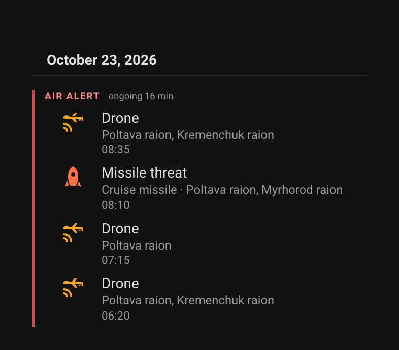
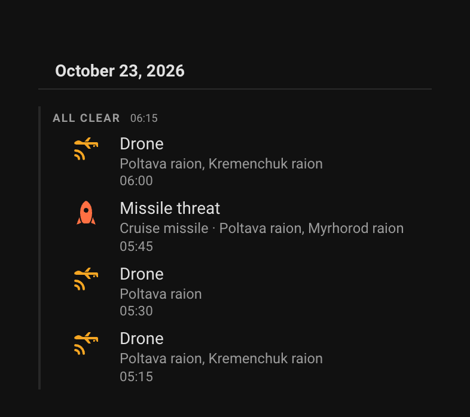

# Wave Poltava

Air-raid monitor for Poltava oblast in one Home Assistant integration: the
channel feed, the wave, the reason rows and the dashboard card.

```
  Telegram preview             Wave Poltava                Home Assistant
  ┌──────────────┐            ┌─────────────────┐         ┌────────────────┐
  │ monitoringplt│─ every 30s▶│ feed parser     │────────▶│ wave sensors   │
  │ public page  │            │ marker classify │         │ local alert    │
  └──────────────┘            │ wave tracker    │         │ reason rows    │
                              │ .storage record │         │ bundled card   │
                              └─────────────────┘         └────────────────┘
```

## Screenshots

| Live alert | After the all-clear |
| --- | --- |
|  |  |

Both are the activity card on a phone. The red rail and the `ТРИВОГА` caption
belong to the alert that is running. Every finished wave starts with a
`ВІДБІЙ` caption on the all-clear row.

## Why it exists

1. The feed is fetched and parsed here. No `rest` sensor, no `scrape` sensor and
   no parser integration is needed.
2. The channel's own words decide when a wave starts and ends. The classifier
   reads marks such as `тривога по БпЛА`, `відбій` and `очікуємо на відбій`.
3. The wave is stored in `.storage`. A restart does not lose a running alert.
4. The card ships inside the integration and is loaded on every page. A HACS
   install does not need a second repository or a manual `/local` copy.

## Entities

| Entity | State | Meaning |
| --- | --- | --- |
| `sensor.air_wave` | `active` / `idle` | the wave |
| `sensor.air_wave_local` | `active` / `idle` | Poltava city, raion or hromada |
| `sensor.air_wave_started` | timestamp | when the wave started |
| `sensor.air_wave_ended` | timestamp | when it ended |
| `sensor.air_wave_duration` | minutes | how long it lasted |
| `sensor.air_wave_label` | text / `—` | the channel's words, untyped |
| `sensor.air_wave_label_drone` | text / `—` | a drone message |
| `sensor.air_wave_label_cruise` | text / `—` | a cruise or generic missile message |
| `sensor.air_wave_label_ballistic` | text / `—` | a ballistic message |
| `sensor.air_wave_label_gab` | text / `—` | a guided-bomb message |
| `binary_sensor.air_threat_local_alert` | `on` / `off` | our area is under alert |
| `sensor.monitoring_poltavshchina_text` | text | newest post, for diagnostics |

Every wave entity carries the same attributes: `wave`, `areas`, `cleared`,
`last_message`, `last_event_type`, `message_count`, `release_after_minutes`,
`waves_today`, `messages_today` and `reason`.

`sensor.air_wave_local` also carries `local_started_at`, `local_last_at` and
`local_cleared_at`. The card uses `local_started_at` for the running alert time.

## Card

`custom:wave-divider-card` is served from the integration. It is the logbook
card with one rail per wave, a `ТРИВОГА` caption while our area is under alert,
and a `ВІДБІЙ` caption on the all-clear row.

The card has one frontend dependency: `custom:multiple-logbook-card` from
[logbook-card](https://github.com/royto/logbook-card). Install it with HACS. The
other two bundled modules, `i18n-card` and `i18n-chrome`, have no dependency.

The card has a visual editor. Add it from the card picker, then change the six
entities, the period, the scroll and the rail thickness or opacity. The default
config already uses the six `air_wave` sensors, so a card added from the picker
works at once.

In YAML the type must be `custom:wave-divider-card`. Home Assistant treats a
bare `wave-divider-card` as a built-in type and stops with "Unknown type
encountered". The card picker adds the `custom:` prefix itself.

## Bubble popup

1. Open the dashboard and press **Edit**.
2. **Add card** → **Bubble Card** → **Pop-up**.
3. Set **Hash** to `#air-wave`. Keep the other fields as they are.
4. Press **Create pop-up**.
5. The new popup opens in edit mode. Press the dashed **Add card** button
   inside it.
6. Choose **Wave divider logbook**.
7. The visual editor opens with the six `air_wave` sensors already filled in.
   Change nothing, or change the period and the rail.
8. Press **Save** in the card editor, then **Save** the dashboard.
9. To open the popup from the air tile, set its tap action to **Navigate** and
   the path to `#air-wave`.

The existing `#aerial-danger-activity` popup uses the same card. Open it in
edit mode to change the card or its position.

## Install

### HACS, as a custom repository

1. HACS, three-dot menu, **Custom repositories**.
2. Add `https://github.com/e-potashkin/wave_poltava`, category **Integration**.
3. Install **Wave Poltava**, then restart Home Assistant.
4. Add the integration in **Settings → Devices & services → Add integration**.
5. Make sure `logbook-card` is installed for the dashboard card.

### Manually

Copy `custom_components/wave_poltava/` into your `config` directory, so that
`config/custom_components/wave_poltava/manifest.json` exists, then restart.

## Options

**Settings → Devices & services → Wave Poltava → Configure** changes one value:

| Option | Default | Meaning |
| --- | --- | --- |
| Release after | 30 min | silence after the last message that ends a wave |

The release delay is not the length of a wave. Every new message moves the
deadline, so a live raid can hold a wave open for hours.

## What counts as ours

The red row follows `poltava_city`, `poltava_raion` and `poltava_rural`. A
message that names only `Полтавська область` does not light it: the oblast is a
different district, and the channel clears one district at a time.

The list lives in `const.py` (`LOCAL_AREAS`).

## Data source

`https://telegram.me/s/monitoringplt` — the public preview of the
**Моніторинг Полтавщина** channel. The integration reads the last twenty-odd
posts, processes only a post id greater than the stored one, and keeps the line
breaks the channel writes.

## License

MIT. Copyright (c) 2026 Eugene Potashkin.
