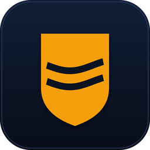

<p align="center"></p>

# Wave Poltava

[](https://hacs.xyz)
[](LICENSE)

Air-raid monitor for Poltava oblast in one Home Assistant integration: the
channel feed, the wave, the reason rows and the dashboard card.

```
  Telegram preview             Wave Poltava                Home Assistant
  ┌──────────────┐            ┌─────────────────┐         ┌────────────────┐
  │ monitoringplt│─ every 30s▶│ feed parser     │────────▶│ wave sensors   │
  │ public page  │            │ marker classify │         │ local alert    │
  └──────────────┘            │ wave tracker    │         │ reason rows    │
                              │ .storage record │         │ bundled card   │
                              └─────────────────┘         └────────────────┘
```

## Features

1. The feed is fetched and parsed here. No `rest` sensor, no `scrape` sensor and
   no parser integration is needed.
2. The channel's own words decide when a wave starts and ends. The classifier
   reads marks such as `тривога по БпЛА`, `відбій` and `очікуємо на відбій`.
3. The wave is stored in `.storage`. A restart does not lose a running alert.
4. The card ships inside the integration and is loaded on every page. A HACS
   install does not need a second repository or a manual `/local` copy.
5. The card's own words follow the Home Assistant profile language: **AIR
   ALERT** / **ALL CLEAR** in English, **ТРИВОГА** / **ВІДБІЙ** in Ukrainian.

## Screenshots

The screenshots use English sample messages. The operator feed is Ukrainian and
the rows show the channel's words as they arrive.

| Live alert | After the all-clear |
| --- | --- |
|  |  |

The red rail and the **AIR ALERT** caption belong to the alert that is running.
The **ALL CLEAR** caption sits on the row that closes a wave, with its time.

## Installation

### HACS, as a custom repository

1. HACS, three-dot menu, **Custom repositories**.
2. Add `https://github.com/e-potashkin/wave_poltava`, category **Integration**.
3. Install **Wave Poltava**, then restart Home Assistant.
4. Add the integration in **Settings → Devices & services → Add integration**.
5. For the dashboard card, install
   [`logbook-card`](https://github.com/royto/logbook-card) from HACS too.

### Manually

Copy `custom_components/wave_poltava/` into your `config` directory, so that
`config/custom_components/wave_poltava/manifest.json` exists, then restart.

## Card

`custom:wave-divider-card` is served from the integration. It is the logbook
card with one rail per wave, a language-aware caption while our area is under
alert, and the all-clear caption on the row that closes the wave.

The card has one frontend dependency: `custom:multiple-logbook-card` from
[logbook-card](https://github.com/royto/logbook-card). Install it with HACS. The
other two bundled modules, `i18n-card` and `i18n-chrome`, have no dependency.

The card has a visual editor. Add it from the card picker, then change the
entities, the period, the scroll and the rail thickness or opacity. The default
config already uses the six `air_wave` sensors, so a card added from the picker
works at once.

```yaml
type: custom:wave-divider-card
hours_to_show: 24
scroll: false
date_format: HH:mm
group_by_day: true
show:
  duration: false
  start_date: true
  end_date: false
  icon: true
  state: true
  entity_name: false
  separator: false
entities:
  - entity: sensor.air_wave_local
    state_map:
      - value: active
        label: AIR ALERT
        icon: mdi:alert-octagon
        icon_color: "#ff5c5c"
      - value: idle
        label: ALL CLEAR
        icon: mdi:shield-check
        icon_color: "#44739e"
    hidden_state: ["active", "—", "unknown", "unavailable"]
  - entity: sensor.air_wave_label_drone
    state_map:
      - value: "*"
        icon: mdi:drone
        icon_color: "#f5a623"
    hidden_state: ["—", "unknown", "unavailable"]
    minimal_duration: 60
divider:
  entity: sensor.air_wave_local
  state: idle
  mode: rail
  thickness: 2
  opacity: 0.16
```

Add `sensor.air_wave_label_cruise`, `_ballistic` and `_gab` the same way to see
every reason row. The labels in `state_map` are placeholders: the card writes
its own live and all-clear words, so they follow the profile language.

In YAML the type must be `custom:wave-divider-card`. Home Assistant treats a
bare `wave-divider-card` as a built-in type and stops with "Unknown type
encountered". The card picker adds the `custom:` prefix itself.

### Bubble card popup

1. Open the dashboard and press **Edit**.
2. **Add card** → **Bubble Card** → **Pop-up**.
3. Set **Hash** to `#air-wave`. Keep the other fields as they are.
4. Press **Create pop-up**.
5. The new popup opens in edit mode. Press the dashed **Add card** button
   inside it.
6. Choose **Wave divider logbook**.
7. The visual editor opens with the six `air_wave` sensors already filled in.
   Change nothing, or change the period and the rail.
8. Press **Save** in the card editor, then **Save** the dashboard.
9. To open the popup from the air tile, set its tap action to **Navigate** and
   the path to `#air-wave`.

## Entities

| Entity | State | Meaning |
| --- | --- | --- |
| `sensor.air_wave` | `active` / `idle` | the wave |
| `sensor.air_wave_local` | `active` / `idle` | Poltava city, raion or hromada |
| `sensor.air_wave_started` | timestamp | when the wave started |
| `sensor.air_wave_ended` | timestamp | when it ended |
| `sensor.air_wave_duration` | minutes | how long it lasted |
| `sensor.air_wave_label` | text / `—` | the channel's words, untyped |
| `sensor.air_wave_label_drone` | text / `—` | a drone message |
| `sensor.air_wave_label_cruise` | text / `—` | a cruise or generic missile message |
| `sensor.air_wave_label_ballistic` | text / `—` | a ballistic message |
| `sensor.air_wave_label_gab` | text / `—` | a guided-bomb message |
| `binary_sensor.air_threat_local_alert` | `on` / `off` | our area is under alert |
| `sensor.monitoring_poltavshchina_text` | text | newest post, for diagnostics |

Every wave entity carries the same attributes: `wave`, `areas`, `cleared`,
`last_message`, `last_event_type`, `message_count`, `release_after_minutes`,
`waves_today`, `messages_today` and `reason`.

`sensor.air_wave_local` also carries `local_started_at`, `local_last_at` and
`local_cleared_at`. The card uses `local_started_at` for the running alert time.

## Options

**Settings → Devices & services → Wave Poltava → Configure** changes one value:

| Option | Default | Meaning |
| --- | --- | --- |
| Release after | 30 min | silence after the last message that ends a wave |

The release delay is not the length of a wave. Every new message moves the
deadline, so a live raid can hold a wave open for hours.

## What counts as ours

The red row follows `poltava_city`, `poltava_raion` and `poltava_rural`. A
message that names only `Полтавська область` does not light it: the oblast is a
different district, and the channel clears one district at a time.

The list lives in `const.py` (`LOCAL_AREAS`).

## Data source

`https://telegram.me/s/monitoringplt` — the public preview of the
**Моніторинг Полтавщина** channel. The integration reads the last twenty-odd
posts, processes only a post id greater than the stored one, and keeps the line
breaks the channel writes.

## Troubleshooting

1. **The card is empty** — install `logbook-card` from HACS. Without
   `multiple-logbook-card` the bundled card cannot draw the rows.
2. **"Unknown type encountered"** — use `custom:wave-divider-card`, not
   `wave-divider-card`.
3. **A wave stays open** — a new message extends the release deadline. Check the
   **Release after** option and the newest value of
   `sensor.monitoring_poltavshchina_text`.
4. **A message about the oblast does not turn the row red** — the row follows
   the city, the raion and the rural hromada only.

## License

MIT. Copyright (c) 2026 Eugene Potashkin.
